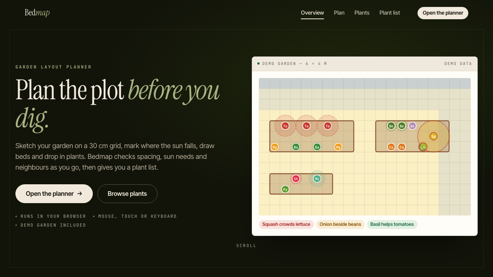
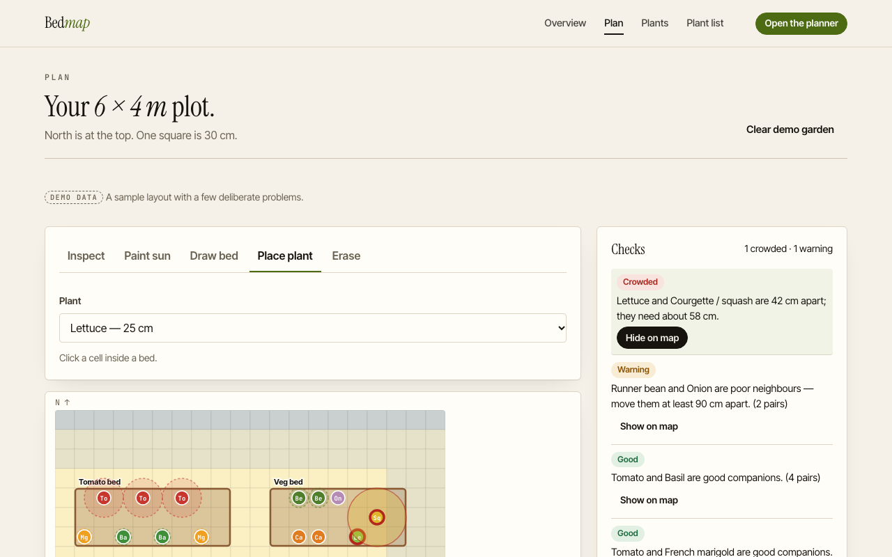
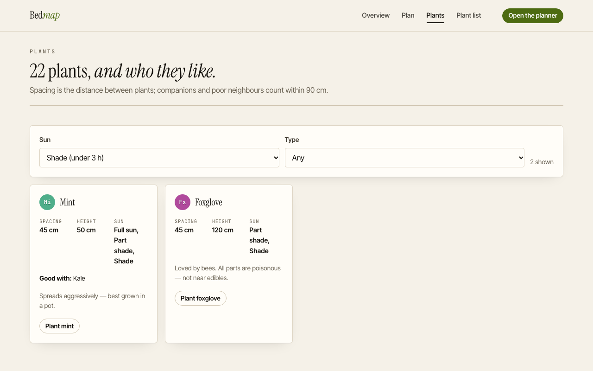
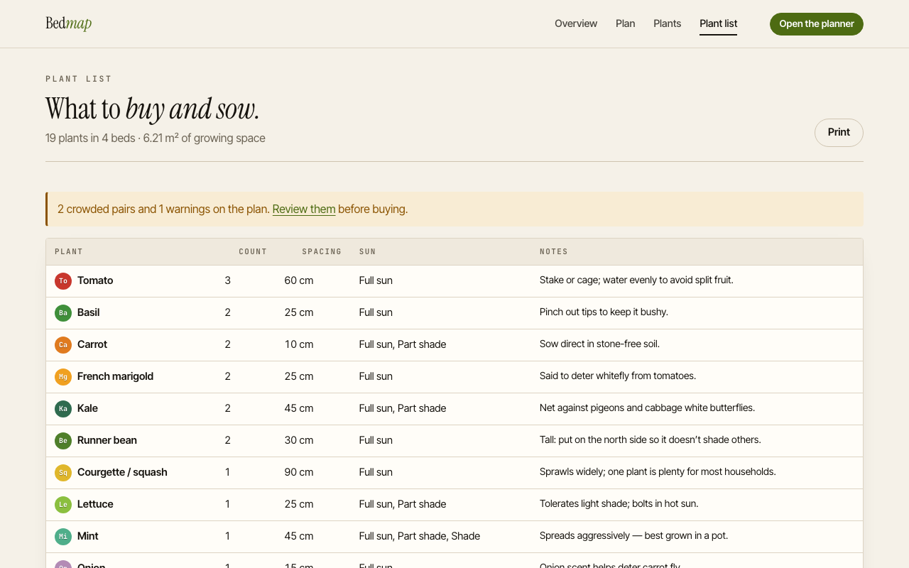

# Bedmap

A garden layout planner. Sketch your plot on a 30 cm grid, paint where the sun falls, draw beds and place plants. Bedmap checks spacing, sun needs, neighbours and shading as you go, and turns the plan into a plant list.

**Live demo:** [https://bedmap.vercel.app/](https://bedmap.vercel.app/) — runs entirely in your browser.



| Plan | Plants | Plant list |
| --- | --- | --- |
|  |  |  |

## Run it

```bash
npm install
npm run dev        # http://localhost:5229
npm test
npm run build
npm run test:e2e   # Playwright smoke test (npm run e2e:install once if Chromium is missing)
```

## Main workflow

1. **Plan** → set the garden size (1–20 m each way). North is at the top; one square is 30 cm.
2. **Paint sun** → drag across cells to mark full sun, part shade or shade.
3. **Draw bed** → drag a rectangle. Beds must fit and can’t overlap; rename them in the Beds panel, which also shows area and how much is in full sun.
4. **Place plant** → pick one of 22 crops, herbs, fruit and flowers and click a cell inside a bed. Each plant’s spread is drawn to scale.
5. **Checks** list crowded pairs, sun mismatches, poor neighbours, tall crops shading sun-lovers and good companions; **Show on map** highlights them.
6. **Erase** removes a plant, or a bed and its plants (with confirmation). **Plant list** gives counts, spacing, sun and growing notes, ready to print.
7. Everything works from the keyboard: focus the grid, use the arrow keys, press Enter to apply the tool (two Enters for bed corners, Shift+arrows to paint sun, Escape to cancel). The plan persists in this browser; the demo garden can be cleared or reloaded.

## Rules

- Crowded: two plants closer than the average of their spacings (centre to centre).
- Sun: a plant on a cell whose sun level isn’t in its list gets a warning.
- Neighbours: poor neighbours within 90 cm are warnings; good companions within 90 cm are noted. Repeats of the same pair are merged with a count.
- Shading: a plant 150 cm or taller up to 90 cm directly south of a shorter, full-sun plant.

## Design

Shared editorial system: Instrument Serif display type, rounded interface text, a leaf-green accent, sun shading on the grid, soil-coloured beds, dashed spread circles and coded plant markers, an ink hero with the demo garden, and a warm paper workspace. Colours have dark-mode variants and motion is removed under `prefers-reduced-motion`.

## Tests

- `src/lib/garden.test.ts` — metre-to-cell conversion, sun painting and resizing, bed validation and area, placement rules, cascade removal, crowding maths, sun/foe/friend/shade checks, plant data integrity, plant counts and sun share.
- `src/App.test.tsx` — demo checks, drawing a bed and planting entirely by keyboard, erasing, painting shade onto a tomato, size validation, catalogue filtering into the planner, plant counts.
- `e2e/smoke.spec.ts` — landing, highlighting an issue, drawing a bed by mouse drag, planting with reload persistence, catalogue filter, plant list, plus 375px layout checks.

## Limitations

- Rules of thumb; varieties, soil and climate change spacing and companions.
- Rectangular beds on a fixed 30 cm grid; no sowing calendar yet.

## Future improvements

- Sowing and harvest calendar by region, crop rotation across seasons, and export to PNG.

## Licence

MIT — see [LICENSE](LICENSE).
